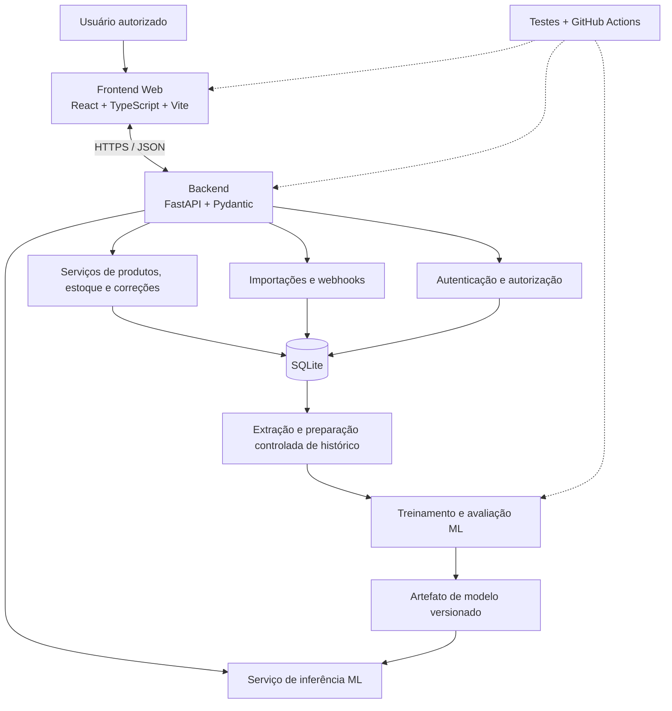

# AutoStock Intelligence — Arquitetura projetada

**Versão:** 0.2 — proposta para aprovação na AS-01  
**Issue:** [AS-01](https://github.com/IkaroGLT/AutoStock-Intelligence/issues/1)  
**Projeto:** AutoStock Intelligence  
**Status:** minuta técnica; não representa implementação concluída.

## 1. Contexto e objetivo

O AutoStock Intelligence é um sistema web acadêmico de gerenciamento de estoque destinado a apoiar pequenos e médios negócios. A proposta é centralizar cadastro, entradas, saídas, correções, importações, automações e alertas, reduzindo conferências manuais diárias e permitindo revisões periódicas baseadas em registros e exceções. Uma camada de Machine Learning poderá apoiar decisões de reposição por previsão de demanda.

O sistema não promete eliminar totalmente inventários físicos, falhas de lançamento ou necessidade de reconciliação. A conferência física periódica continua sendo controle necessário.

## 2. Arquitetura lógica

O frontend não acessa o banco de dados diretamente. A API valida todas as alterações de estoque e aplica transações no banco. O treinamento de ML é separado das rotas transacionais; a API só consome o modelo aprovado para inferência.

## 3. Tecnologias propostas

| Camada | Tecnologia | Responsabilidade |
|---|---|---|
| Frontend | React, TypeScript, Vite | Interface e comunicação com serviços |
| Estilo/UI | Tailwind CSS, shadcn/ui, Recharts | Componentes, responsividade e gráficos |
| Backend | Python, FastAPI, Pydantic | API REST, validação, regras e segurança |
| Banco | SQLite | Persistência transacional e rastreabilidade do MVP |
| Dados/ML | pandas, scikit-learn | Preparação, baseline, treino e inferência |
| Testes | pytest ou unittest, ferramentas frontend/E2E a definir | Unitários, integração e fluxos essenciais |
| CI | GitHub Actions | Lint, testes e build automatizados |
| Documentação | Markdown e evidências acadêmicas | Requisitos, arquitetura, testes e decisões |

Identidade visual prevista para a interface web: preto, dourado e branco. A identidade visual não altera as responsabilidades técnicas das camadas.

## 4. Módulos funcionais

1. **Gestão de usuários e permissões:** autenticação, papéis e proteção de rotas críticas.
2. **Produtos e estoque:** cadastro, consulta, movimentações, histórico e RF-13 (correção auditável de lançamentos).
3. **Automação e monitoramento:** importações CSV/XLSX, webhooks, deduplicação, alertas e sincronizações.
4. **Análise e previsão:** dashboard e estimativa de demanda apoiada por dados históricos adequados.
5. **Qualidade e entrega:** testes, rastreabilidade, documentação e integração contínua.

Os módulos 1–4 oferecem funcionalidades; o módulo 5 é transversal.

## 5. Dados e integridade

**Esquema inicial reaproveitável:** `produtos`, `estoque`, `movimentacoes_estoque`, `eventos_webhook`, `sincronizacoes`, conforme o projeto Mock_Estoque_API. Mudanças para usuários/permissões, referência de correção e usuário responsável precisarão de evolução controlada do modelo.

Regras essenciais:

- SKU único, preços representados em centavos e quantidades não negativas.
- Entradas, saídas e correções executadas transacionalmente.
- Histórico de movimentações não editável/apagável pela aplicação.
- Eventos externos identificados de modo idempotente.
- Segredos não versionados; credenciais de usuário e integração tratadas separadamente.
- Dados históricos adequados para treinamento: não confundir `SAIDA` indiscriminada com venda efetiva; separar ajustes, perdas, transferências e períodos sem observação.

### 5.1. Regra específica de correção (RF-13)

Uma correção de entrada incorreta deve registrar uma **nova movimentação compensatória**, sem alterar a entrada original.

**Diferença = quantidade correta da entrada − quantidade originalmente registrada.** O delta é aplicado ao **saldo atual**, mesmo que outras movimentações tenham ocorrido depois. Exemplo: entrada registrada de 15, saída posterior de 3 (saldo atual 12), entrada deveria ter sido 10; delta = −5; saldo resultante = 7. A correção não deve permitir saldo negativo e precisa registrar quem corrigiu, quando, por quê e a qual movimentação original se refere.

O tipo atual `AJUSTE` da API antiga altera o saldo para um valor final. A reutilização para RF-13 requer uma regra explícita que calcule a compensação e registre o vínculo histórico; não se deve assumir que isso já exista na API anterior.

## 6. Reaproveitamento dos sistemas existentes

**Fonte:** https://github.com/IkaroGLT/Mock_Estoque_API

| Origem | Proposta no AutoStock |
|---|---|
| `schema.sql` | Referência do esquema e restrições, com migrações futuras controladas |
| `init_db.py` | Referência para inicialização e integridade do banco |
| `app.py` | Extrair progressivamente serviços e contratos da API |
| `webhook_routes.py` | Adaptar processamento e idempotência de webhooks |
| `integracao_routes.py` | Adaptar contratos de sincronização |
| `auditoria_estoque.py` | Aproveitar verificações de integridade |
| `tests/` | Reutilizar testes válidos e ampliar cobertura |
| `.github/workflows/tests.yml` | Referência para futura pipeline do novo repositório |

Outra referência: https://github.com/IkaroGLT/fabrica-software-controle-estoque — fluxos visuais de cadastro, entradas, saídas, dashboard e consulta. Ambos os repositórios originais devem permanecer inalterados.

## 7. Escopo da primeira versão (MVP)

**Incluído:** autenticação e permissões, cadastro/consulta/edição de produtos, entrada e saída, correção auditável, histórico, dashboard, alertas de estoque, importação CSV/XLSX, webhooks simulados e deduplicação, previsão de demanda com avaliação explícita de suas limitações, testes e documentação.

**Fora do escopo inicial:** integração em produção com ERP ou e-commerce de terceiros; processamento de pagamentos; múltiplos depósitos com transferência automática; operação offline com sincronização bidirecional; aplicativo nativo; garantia de previsão acurada sem histórico suficiente; eliminação total de inventário físico.

## 7.1. Documentos de decisão complementar

- **Matriz de permissões:** [`matriz-permissoes.md`](matriz-permissoes.md). Define direitos de Administrador, Operador e token de integração; a proteção é sempre executada no backend.
- **Contrato técnico RF-13:** [`contrato-rf13.md`](contrato-rf13.md). Define a correção de entradas manuais, prévia, confirmação, auditoria, idempotência, concorrência e respostas HTTP.

Esses documentos representam **decisões arquiteturais propostas**, sujeitas à revisão da equipe antes da aprovação no Pull Request da AS-01. A implementação de endpoints e tabelas ocorre nas Issues correspondentes, não nesta etapa documental.

## 8. Dependências e decisões pendentes

- **AS-01:** aprovar requisitos, contratos principais e escopo.
- **AS-02:** organizar estrutura e inicializar frontend/backend, preservando originais.
- **AS-03:** desenhar credenciais e papéis, inclusive permissão para RF-13.
- **AS-04/05:** interface e API do RF-13, com contrato validado.
- **AS-07/08:** confirmar disponibilidade e qualidade da série histórica de demanda antes de comprometer o resultado preditivo.
- **AS-09/10:** cobertura, testes e CI.
- **AS-11/12:** evidências e entrega acadêmica.

## 9. Registro de aprovação

- [ ] Arquitetura revisada pela equipe.
- [ ] Requisitos e limites do MVP aprovados.
- [ ] Dependências comunicadas aos responsáveis.
- [ ] Aprovação registrada na AS-01, com data e responsável.
